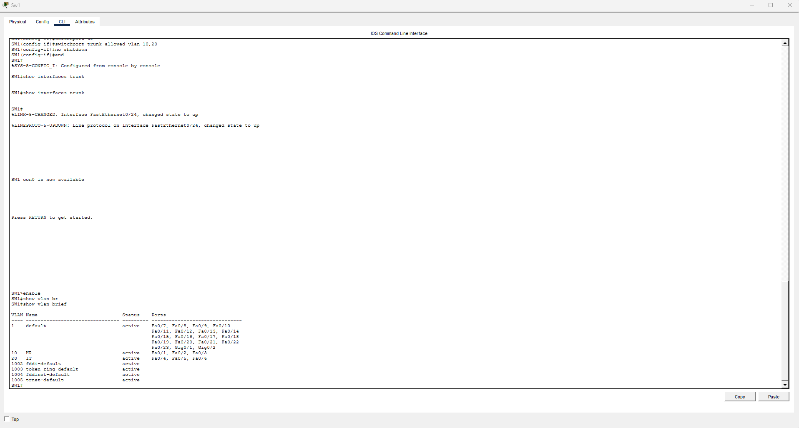
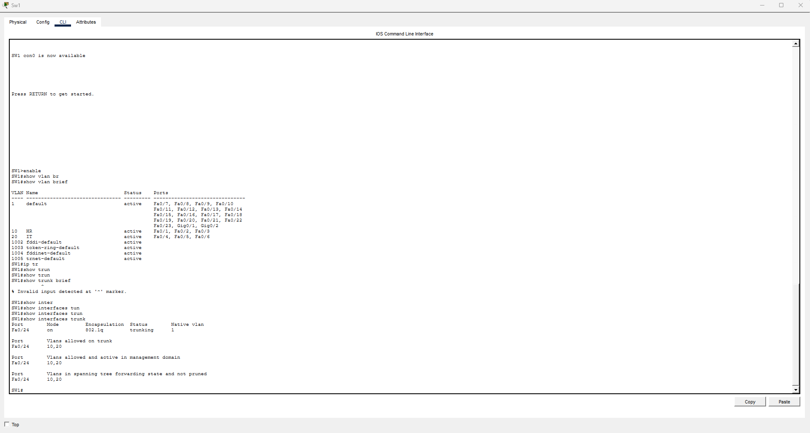
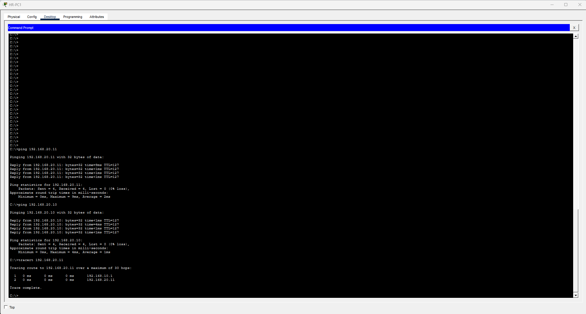
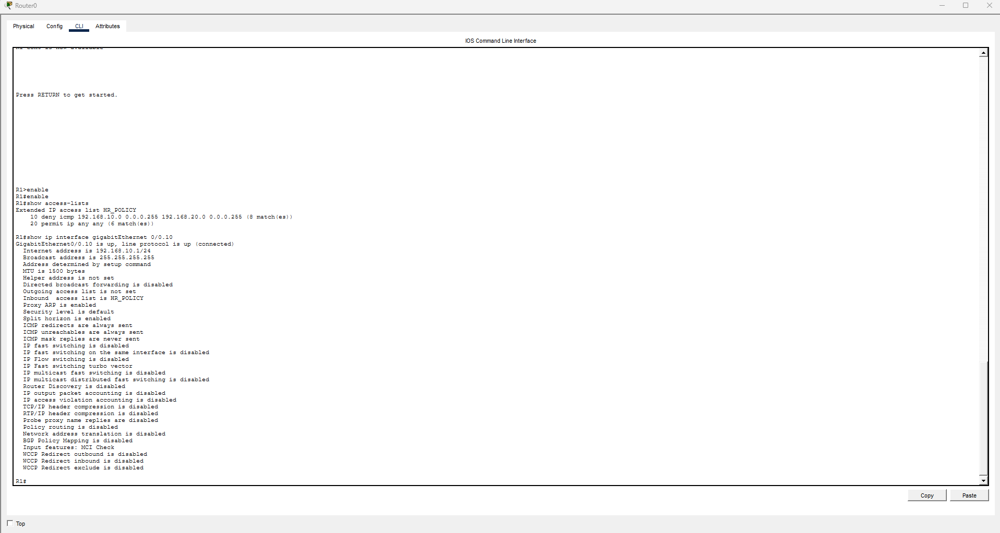
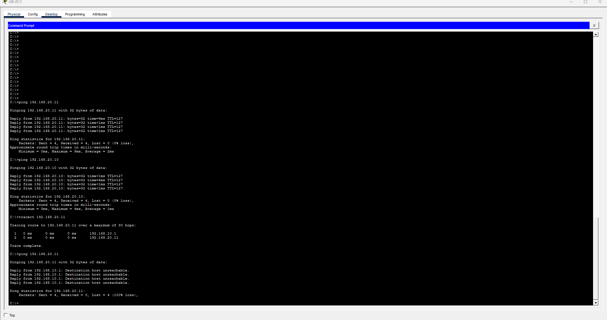

# Lab 03 – VLAN Segmentation, Router-on-a-Stick & Extended ACL

## Overview

This lab demonstrates how to segment a small enterprise network into separate VLANs, enable inter-VLAN routing using Router-on-a-Stick, and implement an Extended Access Control List (ACL) to restrict communication between departments.

The network was designed and tested using Cisco Packet Tracer.

## Objectives

- Configure VLAN 10 for the HR department and VLAN 20 for the IT department.
- Assign switch access ports to the appropriate VLANs.
- Configure an IEEE 802.1Q trunk between the switch and router.
- Enable inter-VLAN routing using router subinterfaces.
- Implement an Extended ACL to block ICMP traffic from HR to IT.
- Verify connectivity before and after applying the ACL.
- Troubleshoot and document network behavior.

## Network Topology

The lab consists of:

- 1 Cisco router (R1)
- 1 Cisco switch (SW1)
- 2 HR workstations
- 2 IT workstations
- 1 HR web server
- 1 IT file server

All end devices connect to SW1, which connects to R1 through an 802.1Q trunk.

## IP Addressing

| Device | VLAN | IP Address | Default Gateway |
|---|---|---|---|
| R1 G0/0.10 | 10 | 192.168.10.1/24 | N/A |
| R1 G0/0.20 | 20 | 192.168.20.1/24 | N/A |
| HR Server (WEB) | 10 | 192.168.10.10 | 192.168.10.1 |
| HR-PC1 | 10 | 192.168.10.11 | 192.168.10.1 |
| HR-PC2 | 10 | 192.168.10.12 | 192.168.10.1 |
| IT Server (FILE) | 20 | 192.168.20.10 | 192.168.20.1 |
| IT-PC1 | 20 | 192.168.20.11 | 192.168.20.1 |
| IT-PC2 | 20 | 192.168.20.12 | 192.168.20.1 |

## VLAN Configuration

Two VLANs were configured on SW1:

- VLAN 10 – HR
- VLAN 20 – IT

The switch access ports were assigned as follows:

| Interface | VLAN | Purpose |
|---|---|---|
| Fa0/1–Fa0/3 | 10 | HR devices |
| Fa0/4–Fa0/6 | 20 | IT devices |
| Fa0/24 | Trunk | Connection to R1 |

Verification command:

`show vlan brief`

The output confirmed that both VLANs were active and their access ports were assigned correctly.



## Router-on-a-Stick Configuration

Router-on-a-Stick enables communication between multiple VLANs using one physical router interface with separate logical subinterfaces.

The router uses the following subinterfaces:

**VLAN 10 – HR**

```cisco
interface GigabitEthernet0/0.10
 encapsulation dot1Q 10
 ip address 192.168.10.1 255.255.255.0
```

**VLAN 20 – IT**

```cisco
interface GigabitEthernet0/0.20
 encapsulation dot1Q 20
 ip address 192.168.20.1 255.255.255.0
```

The switch trunk was configured to carry VLAN 10 and VLAN 20 traffic.

```cisco
interface FastEthernet0/24
 switchport mode trunk
 switchport trunk allowed vlan 10,20
 no shutdown
```

Verification command:

`show interfaces trunk`

The output confirmed:

- Trunk port: Fa0/24
- Encapsulation: 802.1Q
- Operational status: trunking
- Allowed VLANs: 10, 20
- Both VLANs forwarding traffic



## Inter-VLAN Connectivity Test

Before applying the ACL, connectivity was tested between HR and IT devices.

From HR-PC1:

```text
ping 192.168.20.11
ping 192.168.20.10
tracert 192.168.20.11
```

**Results:**

- HR-PC1 successfully communicated with IT-PC1.
- HR-PC1 successfully reached the IT server.
- Traceroute confirmed that traffic passed through the router.
- Inter-VLAN routing was operational.



## Extended ACL Configuration

### Security Requirement

The HR department must not initiate ICMP communication with devices in the IT subnet.

Other IP traffic is permitted by this lab policy.

### ACL Configuration

An Extended ACL named `HR_POLICY` was configured on R1.

```cisco
ip access-list extended HR_POLICY
 deny icmp 192.168.10.0 0.0.0.255 192.168.20.0 0.0.0.255
 permit ip any any
```

The ACL was applied inbound on the VLAN 10 subinterface:

```cisco
interface GigabitEthernet0/0.10
 ip access-group HR_POLICY in
```

### Explanation

- `deny icmp` blocks ICMP packets from the HR subnet to the IT subnet.
- `permit ip any any` allows other IP traffic.
- `in` applies the policy to traffic entering the router from VLAN 10.

The ACL blocks all ICMP types matching the source and destination networks, not only ICMP Echo Requests.

## ACL Verification

The following commands were used:

```cisco
show access-lists
show ip interface gigabitEthernet0/0.10
```

The router output confirmed that:

- The `HR_POLICY` ACL was configured.
- The ACL was applied inbound on G0/0.10.
- The deny rule recorded packet matches.
- The permit rule remained available for other IP traffic.



## Connectivity Test After Applying ACL

From HR-PC1:

```text
ping 192.168.20.11
```

**Observed result:**

```text
Reply from 192.168.10.1:
Destination host unreachable.

Packets: Sent = 4, Received = 0
Lost = 4 (100% loss)
```

The router rejected the matching ICMP traffic, confirming that the ACL was functioning as intended.



## Troubleshooting and Verification

During the lab, connectivity was tested before and after ACL deployment to distinguish routing problems from security-policy restrictions.

| Test | Expected Result | Observed Result |
|---|---|---|
| VLAN 10 and VLAN 20 status | Active | Passed |
| Switch trunk | Trunking | Passed |
| Inter-VLAN ping before ACL | Successful | Passed |
| HR → IT ping after ACL | Blocked | Passed |
| ACL applied inbound | HR_POLICY | Passed |
| ACL deny counter | Incrementing | Passed |

### Key Troubleshooting Lessons

1. Verify VLAN assignments before troubleshooting routing.
2. Confirm that the switch trunk carries the required VLANs.
3. Verify router subinterface IP addresses and 802.1Q encapsulation.
4. Test connectivity before applying security policies.
5. Check ACL direction and rule order.
6. Use ACL hit counters to confirm whether traffic matches a rule.

## Security Considerations

This ACL provides basic Layer 3 traffic filtering between departments.

However, the implemented policy is limited:

- It blocks ICMP traffic from HR to IT.
- It does not block TCP or UDP traffic between the departments.
- It does not automatically block traffic initiated from IT to HR.
- It does not provide stateful firewall inspection.

In a production environment, security policies should be designed around business requirements, least-privilege access, logging, and appropriate network segmentation.

## Skills Demonstrated

- Cisco IOS CLI configuration
- VLAN segmentation
- Switch access-port configuration
- IEEE 802.1Q trunking
- Router-on-a-Stick
- Inter-VLAN routing
- Extended ACL configuration
- Inbound traffic filtering
- ICMP troubleshooting
- Network connectivity verification
- Technical documentation

## Conclusion

This lab successfully demonstrated VLAN segmentation, inter-VLAN routing, and traffic filtering using an Extended ACL.

Initially, HR and IT devices could communicate through the router. After applying `HR_POLICY`, ICMP communication from HR to IT was blocked as intended.

The lab provided practical experience with Cisco switching, routing, ACL configuration, and systematic network troubleshooting.

## Tools

- Cisco Packet Tracer
- Cisco IOS CLI
- Visual Studio Code
- Git and GitHub

---

**Repository:** [packet-tracer-labs](https://github.com/Enkhbayan-IT/packet-tracer-labs)

**Lab:** 03 – VLAN Segmentation, Router-on-a-Stick & Extended ACL

