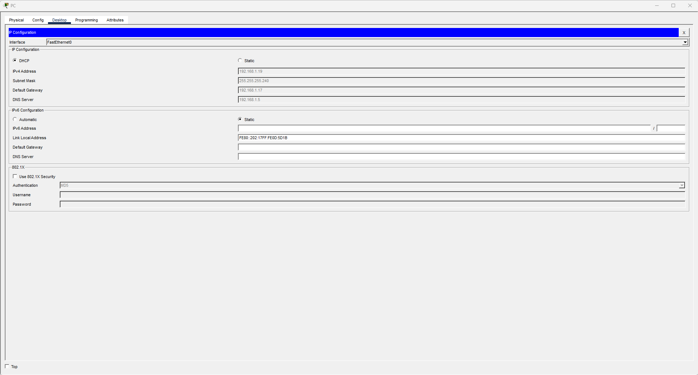
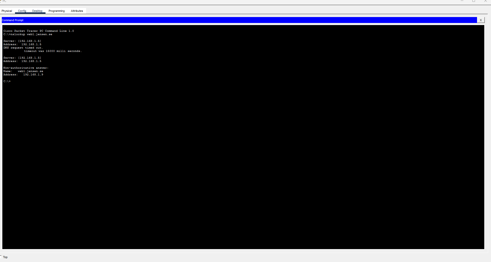

# Lab 04 – Enterprise Network Services

## Overview

This lab demonstrates the configuration and integration of essential enterprise network services using Cisco Packet Tracer.

The network consists of two separate IPv4 subnets connected through a Cisco router. Multiple servers provide DHCP, DNS, HTTP, FTP, and Email services, while wired and wireless clients access the network.

The lab focuses on IP addressing, DHCP relay, inter-subnet routing, application-layer services, and network troubleshooting.

## Objectives

- Configure two separate IPv4 subnets using /28 subnet masks.
- Configure router interfaces and enable inter-subnet communication.
- Configure a centralized DHCP server.
- Implement DHCP relay using `ip helper-address`.
- Configure DNS records for internal services.
- Configure HTTP, FTP, and Email services.
- Connect wired and wireless clients.
- Verify network connectivity and service availability.
- Document configurations and troubleshooting results.

## Network Topology

The topology contains:

- 1 Cisco router (R1)
- 2 access switches
- 1 wireless access point
- 2 wired PCs
- 1 wireless laptop
- 5 servers providing enterprise network services

### IP Addressing

| Device / Interface | IP Address | Subnet Mask | Purpose |
|---|---|---|---|
| R1 – G0/0 | 192.168.1.1 | 255.255.255.240 | Server LAN gateway |
| R1 – G0/1 | 192.168.1.17 | 255.255.255.240 | Client LAN gateway |
| DNS Server | 192.168.1.5 | 255.255.255.240 | DNS |
| DHCP Server | 192.168.1.6 | 255.255.255.240 | DHCP |
| Mail Server | 192.168.1.7 | 255.255.255.240 | Email |
| FTP Server | 192.168.1.8 | 255.255.255.240 | FTP |
| Web Server | 192.168.1.9 | 255.255.255.240 | HTTP |

### Subnet Design

**Server LAN**

- Network: `192.168.1.0/28`
- Usable addresses: `192.168.1.1–192.168.1.14`
- Default gateway: `192.168.1.1`

**Client LAN**

- Network: `192.168.1.16/28`
- Usable addresses: `192.168.1.17–192.168.1.30`
- Default gateway: `192.168.1.17`

## Router Configuration

R1 connects the server and client subnets.

```cisco
enable
configure terminal

interface GigabitEthernet0/0
 description Connected to Server LAN
 ip address 192.168.1.1 255.255.255.240
 no shutdown
 exit

interface GigabitEthernet0/1
 description Connected to Client LAN
 ip address 192.168.1.17 255.255.255.240
 ip helper-address 192.168.1.6
 no shutdown
 exit

end
copy running-config startup-config
```

### DHCP Relay

The DHCP server is located in the server subnet, while DHCP clients are located in a different subnet.

Because DHCP discovery initially uses broadcasts, a DHCP relay agent is required to forward DHCP requests between the subnets.

The following command is configured on R1's client-facing interface:

```cisco
ip helper-address 192.168.1.6
```

This allows clients in the `192.168.1.16/28` subnet to obtain IP configuration from the DHCP server.

## Enterprise Services

### DHCP

The DHCP server provides automatic IPv4 configuration for client devices.

DHCP relay was configured on R1, and a client successfully obtained an IP address from the DHCP server.



### DNS

The DNS server is assigned the address `192.168.1.5`.

The lab includes the internal domain `jensen.se` and named services such as:

- `ns1.jensen.se`
- `web1.jensen.se`
- `mail.jensen.se`
- `ftp.jensen.se`

DNS configuration and verification evidence are included in the repository.



### HTTP

The web server is assigned `192.168.1.9`.

The HTTP service is intended to provide access to the internal website through a browser.

### FTP

The FTP server is assigned `192.168.1.8`.

The FTP service is included to demonstrate application-layer file transfer.

### Email

The mail server is assigned `192.168.1.7`.

The email service is included to demonstrate client-to-server messaging using email protocols.

### Wireless Networking

A wireless access point is connected to the client LAN to provide wireless network access for a laptop.

## Verification and Testing

The following commands can be used to verify network connectivity and configuration.

**Router interface verification**

```cisco
show ip interface brief
show ip route
show running-config
```

**Client IP configuration**

```cmd
ipconfig /all
```

**Gateway connectivity**

```cmd
ping 192.168.1.17
```

**DHCP server connectivity**

```cmd
ping 192.168.1.6
```

**DNS server connectivity**

```cmd
ping 192.168.1.5
```

**Web server connectivity**

```cmd
ping 192.168.1.9
```

**DNS resolution**

```cmd
nslookup web1.jensen.se
```

### Confirmed Results

| Test | Result |
|---|---|
| R1 G0/0 interface | Up/Up |
| R1 G0/1 interface | Up/Up |
| DHCP relay configuration | Configured |
| Client DHCP address assignment | Successful |
| DNS resolution | Evidence included; result not independently confirmed |
| HTTP service | Evidence included; result not independently confirmed |
| FTP service | Evidence included; result not independently confirmed |
| Email service | Evidence included; result not independently confirmed |
| Wireless connectivity | Evidence included; result not independently confirmed |

## Repository Structure

```text
Lab 04 – Enterprise Network Services/
│
├── configuration/
│   ├── R1.txt
│   ├── dhcp-config.png
│   ├── dns-config.png
│   ├── email-config.png
│   └── ftp-config.png
│
├── screenshots/
│   ├── dhcp-verification.png
│   ├── dns-verification.png
│   ├── email-verification.png
│   ├── ftp-verification.png
│   ├── http-verification.png
│   └── wifi-verification.png
│
└── README.md
```

## Troubleshooting and Lessons Learned

This lab provided practical experience with:

- Understanding IPv4 subnet boundaries and default gateways.
- Configuring multiple routed interfaces on a Cisco router.
- Understanding why DHCP broadcasts do not normally cross routers.
- Using DHCP relay to centralize IP address assignment.
- Separating network-layer connectivity from application-layer service testing.
- Verifying network configurations using Cisco IOS and client commands.
- Organizing configuration files and verification screenshots for technical documentation.

## Conclusion

This lab demonstrates a small enterprise network architecture with centralized services and multiple IP subnets.

The router interfaces and DHCP relay functionality were configured successfully, and DHCP address assignment was verified.

The lab also includes configuration and verification artifacts for DNS, HTTP, FTP, Email, and wireless networking.

**Tools:** Cisco Packet Tracer, Cisco IOS CLI, GitHub

**Skills:** IPv4 Subnetting, Routing, DHCP Relay, DNS, HTTP, FTP, Email Services, Wireless Networking, Network Troubleshooting

**Author:** Enkhbayan-IT
